# Phase P3 — Retargeted Animations, Projectiles, Super/Junoon VFX & Air Attacks

22 November 2026 (Phase P3 Parts 1, 2 & 3 — Complete). Phase P3 replaces procedural/placeholder states for both **Khan Sahab** and **Asim Jani** with retargeted Mixamo and Motifect BVH animation libraries (`36` Khan clips, `38` Asim clips), locks root XY drift across attack/locomotion clips and Z lift on aerial attacks, adds Khan's ranged **Patthar Throw** + Asim's **M1911 Pistol Shot**, wires round entries, post-KO victory dances, auto-face `Turn180`, reworked `JalwaSuper` with 3D lightning/slash/crater VFX, full-body Junoon fire aura, `SweepFall` / `Stand Up` knockdowns (keeping `KnockdownDeath` for KOs), and mid-air **Flying Knee Punch** & **Drop Kick** attacks.

Launch the live prototype via [Play Combat Prototype.cmd](../Play%20Combat%20Prototype.cmd) (or open `game/` in Godot 4.7.2 and press **F5**). Press **`J+K`** (P1) or **`Num1+Num2`** (P2) while standing to taunt, press **`[` / `1+3`** at range for `Patthar Throw` / `M1911 Pistol Shot`, tap an attack while jumping for `JumpPunch` / `JumpKick`, press **`F6`** for instant full **Josh (`100`) + Junoon**, and press **`F7`** (or launch [Play Asim Moves Demo.cmd](../Play%20Asim%20Moves%20Demo.cmd)) for the single-button Asim showcase.

## Character animation builds

Built by `tools/blender/build_p3_character_anims.py` (FBX Mixamo retargeting + Motifect BVH world-space T-pose delta retargeting via `BVH_TO_MIXAMO`, `lock_xy=True` on grounded clips and `lock_z=True` on aerial clips) and logged in [build-report.json](build-report.json) (`0` NaN keyframes, `max_locked_hips_xy_drift_m: 0.0`):

| Fighter | GLB | Tris (source → LOD0) | Size | Skin joints | Clips |
|---|---|---:|---:|---:|---:|
| **Khan Sahab** | `game/assets/characters/khan_recovery_trial.glb` | 292,869 → **65,877** | 14.47 MB | 239 (incl. kameez drape bones) | **36** |
| **Asim Jani** | `game/assets/characters/asim_model1.glb` | 284,999 → **61,999** | 9.08 MB | 65 | **38** |

- **Khan Sahab (36 retargeted clips):** `LightCombo`, `MmaKick`, `Idle`, `Idle2` (`Bouncing Fight Idle.fbx`, 90f), `Walk`, `WalkBack` (`Step Backward.fbx`), `Jump` (`Jumping.fbx`), `CrouchIdle`, `CrouchWalk`, `CrouchWalkBack`, `DashForward`, `Backdash`, `Sidestep`, `Punch`, `CrossPunch`, `RightHook`, `LeftKick`, `CrescentSweep`, `FlipKick`, `QuadPunch`, `RoundhouseKick`, `ThrowRock`, `SignatureKick`, `HitHead`, `HitBody`, `SweepFall` (`Sweep Fall.fbx`, 76f), `KnockdownDeath` (`Character Death.fbx`, 90f), `BlockHit` (`BVH/block_mid.bvh`, 55f), `WakeupStand` (`Stand Up.fbx` slice 45..200, 156f), `Taunt` (`Standing Taunt Battlecry.fbx`, 86f), `Turn180` (`Running Turn 180.fbx`, 21f), `Entry` (`Entry (1).fbx`, 101f walk-in ending at fighting mark), `VictoryCelebrate` (`Rumba Dancing.fbx`, 72f), `JumpPunch` (`Flying Knee Punch Combo.fbx` slice 19..50, 32f), `JumpKick` (`Drop Kick.fbx` slice 25..51, 27f), `JalwaSuper` (reworked composite 100f).
- **Asim Jani (38 retargeted clips):** `Idle`, `Punch`, `MmaKick`, `QuadPunch`, `RoundhouseKick`, `Headbutt`, `Idle2`, `Walk`, `WalkBack`, `CrouchIdle`, `CrouchWalk`, `CrouchWalkBack`, `DashForward`, `Backdash`, `Sidestep` (`BVH/dodge_left.bvh`, 55f), `Jump`, `JabLeft`, `JabCross`, `CrossRight`, `BodyPunch`, `FrontKick`, `SweepKick`, `UppercutRight`, `GrabThrow`, `ComboPunchKick`, `BlockHit`, `HitHead`, `HitBody`, `SweepFall` (`Sweep Fall.fbx`, 76f), `KnockdownDeath`, `WakeupStand` (`Stand Up.fbx` slice 45..200, 156f), `Taunt` (`BVH/salute_military.bvh`, 100f), `Turn180`, `Entry` (`Crouch To Stand.fbx`, 78f), `VictoryCelebrate` (`Silly Dancing.fbx`, 116f), `ShootPistol` (`shoot/Shooting.fbx`, 36f), `JumpPunch` (`Flying Knee Punch Combo.fbx` slice 19..50, 32f), `JumpKick` (`Drop Kick.fbx` slice 25..51, 27f).
- **Synced `.tres` resources (`FrameDataTool.save_default_resources()`):** `game/characters/khan/CharacterDef.tres` (`16` moves, full `clip_map`) and `game/characters/asim/CharacterDef.tres` (`16` moves incl. `pistol_shoot.tres`, `air_punch.tres`, `air_kick.tres`, full `clip_map`) match `CharacterDef` defaults 1:1 on disk.
- **Stand ↔ crouch smoothing & hip locks:** `FighterView` slows standing ↔ crouch transitions (`CROUCH_TRANSITION_XFADE = 0.28` s) while keeping attacks/hits/dashes at `0.06` s; `lock_xy=True` prevents horizontal capsule drift (`0.0 m`) and `lock_z=True` on `JumpPunch`/`JumpKick` prevents vertical double-jump offsets.

## Move → clip tables (`32` total MoveData attacks)

Authoritative **32-row** frame data (`16` Khan + `16` Asim) lives in [frame-data.md](frame-data.md) ([frame-data.csv](frame-data.csv)).

### Khan Sahab (`16` MoveData attacks)

| Move ID | Display Name | Clip | Level | Tracking | Startup | Active | Recovery | Total | Dmg | On Hit | On Block | Properties |
|---|---|---|---|---|---|---|---|---|---|---|---|---|
| `air_kick` | Drop Kick (Air 3/4) | `JumpKick` | mid | linear | i9 | 7f | 16f | 32f | 16 | +12 | +0 | knockdown |
| `air_punch` | Flying Knee Punch (Air 1/2) | `JumpPunch` | mid | linear | i7 | 6f | 14f | 27f | 13 | +10 | +0 | - |
| `command_heavy` | Kaptaan Barrage (f+2) | `QuadPunch` | mid | homing | i14 | 4f | 20f | 38f | 20 | +7 | -4 | wall_splat |
| `crouch_jab` | Right Hook (d+1) | `RightHook` | mid | linear | i7 | 3f | 13f | 23f | 8 | +3 | -2 | - |
| `heavy_punch` | Right Cross (2) | `CrossPunch` | mid | linear | i13 | 4f | 25f | 42f | 14 | -4 | -11 | cancels:kick |
| `kick` | Heavy Kick (4) | `MmaKick` | mid | linear | i12 | 4f | 22f | 38f | 17 | +3 | -5 | - |
| `launcher` | Flip Kick Launcher (df+2) | `FlipKick` | mid | linear | i18 | 5f | 32f | 55f | 15 | +6 | -16 | launcher |
| `light_combo` | Twin Jab (1,1) | `LightCombo` | high | linear | i5 | 3f | 14f | 22f | 8 | +4 | -2 | cancels:heavy_punch |
| `low_sweep` | Chappal Sweep (d+3) | `CrescentSweep` | low | linear | i18 | 5f | 32f | 55f | 16 | -2 | -10 | knockdown |
| `power_kick` | Kaptaan Roundhouse (b+4) | `RoundhouseKick` | mid | homing | i15 | 5f | 24f | 44f | 22 | +5 | -6 | wall_splat |
| `punch` | Left Jab (1) | `Punch` | high | linear | i6 | 3f | 14f | 23f | 10 | +4 | -2 | cancels:light_combo,heavy_punch |
| `quick_kick` | Low Shin Kick (3) | `LeftKick` | low | linear | i10 | 3f | 18f | 31f | 11 | +1 | -5 | - |
| `rock_throw` | Patthar Throw (1+3) | `ThrowRock` | high | linear | i44 | 4f | 32f | 80f | 18 | +2 | -18 | - |
| `signature` | Bouncer Kick (1+2) | `SignatureKick` | mid | linear | i20 | 6f | 32f | 58f | 24 | +0 | -14 | knockdown;wall_splat |
| `super_jalwa` | Kaptaan Jalwa (JOSH) | `JalwaSuper` | mid | homing | i11 | 6f | 34f | 51f | 34 | +6 | -14 | knockdown;wall_splat;chip:8 |
| `throw_front` | Pakad Throw (1+3) | `Punch` | throw | linear | i10 | 3f | 22f | 35f | 22 | +8 | -22 | knockdown |

### Asim Jani (`16` MoveData attacks)

| Move ID | Display Name | Clip | Level | Tracking | Startup | Active | Recovery | Total | Dmg | On Hit | On Block | Properties |
|---|---|---|---|---|---|---|---|---|---|---|---|---|
| `air_kick` | Drop Kick (Air 3/4) | `JumpKick` | mid | linear | i9 | 7f | 16f | 32f | 16 | +12 | +0 | knockdown |
| `air_punch` | Flying Knee Punch (Air 1/2) | `JumpPunch` | mid | linear | i7 | 6f | 14f | 27f | 13 | +10 | +0 | - |
| `command_heavy` | Iron Headbutt (f+2) | `Headbutt` | mid | homing | i14 | 4f | 20f | 38f | 20 | +7 | -4 | wall_splat |
| `crouch_jab` | Body Blow (d+1) | `BodyPunch` | mid | linear | i7 | 3f | 13f | 23f | 8 | +3 | -2 | - |
| `heavy_punch` | Right Cross (2) | `CrossRight` | mid | linear | i13 | 4f | 25f | 42f | 14 | -4 | -11 | cancels:kick |
| `kick` | Heavy Kick (4) | `MmaKick` | mid | linear | i12 | 4f | 22f | 38f | 17 | +3 | -5 | - |
| `launcher` | Commander Uppercut (df+2) | `UppercutRight` | mid | linear | i18 | 5f | 32f | 55f | 15 | +6 | -16 | launcher |
| `light_combo` | Twin Jab (1,1) | `JabCross` | high | linear | i5 | 3f | 14f | 22f | 8 | +4 | -2 | cancels:heavy_punch |
| `low_sweep` | Boot Sweep (d+3) | `SweepKick` | low | linear | i18 | 5f | 32f | 55f | 16 | -2 | -10 | knockdown |
| `pistol_shoot` | M1911 Pistol Shot (1+3) | `ShootPistol` | high | linear | i18 | 4f | 30f | 52f | 16 | -2 | -16 | chip:3 |
| `power_kick` | Commander Roundhouse (b+4) | `RoundhouseKick` | mid | homing | i15 | 5f | 24f | 44f | 22 | +5 | -6 | wall_splat |
| `punch` | Left Jab (1) | `JabLeft` | high | linear | i6 | 3f | 14f | 23f | 10 | +4 | -2 | cancels:light_combo,heavy_punch |
| `quick_kick` | Front Boot (3) | `FrontKick` | low | linear | i10 | 3f | 18f | 31f | 11 | +1 | -5 | - |
| `signature` | Salute & Strike (1+2) | `QuadPunch` | mid | linear | i20 | 6f | 32f | 58f | 24 | +0 | -14 | knockdown;wall_splat;armour:1 |
| `super_jalwa` | Commander Jalwa (JOSH) | `ComboPunchKick` | mid | homing | i11 | 6f | 26f | 43f | 34 | +14 | -6 | knockdown;wall_splat;chip:8 |
| `throw_front` | Military Throw (1+3) | `GrabThrow` | throw | linear | i10 | 3f | 22f | 35f | 22 | +8 | -22 | knockdown |

## Part 3 Features: Entries, Victory, Turn180, Pistol, Super/Junoon VFX, Knockdowns & Air Attacks

- **Round entries, KO wait → Victory dances & `Turn180`:** Round start plays Khan's `Entry` (walking in from afar onto his fighting mark at `FIGHT`) and Asim's `Crouch To Stand`; post-KO victory (`Rumba Dancing` / `Silly Dancing`) waits for `KO_FALL_TICKS = 108` (`1.80 s`) before celebrating; side-switch triggers `Running Turn 180`.
- **Khan "Patthar Throw" (`1+3` at range):** Uses `game/assets/props/cliff_rock.glb` (`946` tris) and `game/assets/props/cliff_rock_shards.glb` (`1,044` tris: 6 jagged PBR chunks) + `dust_puff.png`, spawning 12 ground-bouncing shards on impact (`18` dmg, `HitHead`, `3` chip on stand guard, crouch ducks cleanly).
- **Asim "M1911 Pistol Shot" (`1+3` at range / direct hotkey):** Built via `tools/blender/build_pistol_props.py` ([pistol-props-report.json](pistol-props-report.json)) -> `game/assets/props/m1911_pistol.glb` (`12,080` tris, 6 PBR materials + `MuzzlePoint`) and `game/assets/props/bullet_45acp.glb` (`736` tris). Spawns muzzle flash, ejecting brass casing, gunshot SFX, and high `.45 ACP` bullet (`16` dmg, `HitBody`, `3` chip on stand guard, crouch ducks cleanly).
- **Reworked `JalwaSuper` + Super/Full-Junoon VFX (`tools/blender/build_super_vfx_assets.py`):** Reported in [super-vfx-assets-report.json](super-vfx-assets-report.json). Adds `14` VFX textures + 4 shaders + `lightning_bolts.glb` (`BoltSky_0..2`, `BoltArc_0`) + `slash_arc.glb` (`SlashWave`, `SlashCrescent`) under `game/assets/vfx/`:
  - **Full-Junoon (`Josh == 100` / `junoon_active` / `super_jalwa`):** Full-body fire shader overlay (`junoon_body_fire.gdshader`, dynamically attached only while active so non-Junoon frames stay at normal primitive counts with zero quality compromise), inner/outer volumetric flame shrouds, ground blaze ring, rising flame plumes, and embers.
  - **`JalwaSuper` finisher:** Storm sky/sun dimming, `BoltSky_0` startup summon + rune circle, twin finisher lightning bolts + horizontal arc (`lightning_arc.gdshader`), curved 3D `SlashWave` (`energy_slash.gdshader`), glowing `ground_crack` decal (`ground_crack.gdshader`), star flare + ember burst, while preserving the fixed `48`-spark `CombatFeedback` direct child pool.
- **Hit Knockdown (`SweepFall`), Stand-Up (`WakeupStand`), & KO (`KnockdownDeath`):** Non-lethal knockdowns (`low_sweep`, `signature`, `throw_front`, `super_jalwa`, `air_kick`, juggle landing) drop immediately into `SweepFall` (`KNOCKDOWN_TICKS = 76` / `1.27 s`, seek `0.85..2.30`) followed by `Stand Up.fbx` (`WAKEUP_STAND_TICKS = 72` / `1.20 s`), while lethal KOs continue to use `KnockdownDeath` (`KO_FALL_TICKS = 108` / `1.80 s`).
- **Aerial attacks (`JumpPunch` & `JumpKick`):** One air attack per jump (preserving horizontal air momentum and canceling cleanly on touchdown) using `Flying Knee Punch Combo.fbx` (`i7 / 6f / 14f`, `13` dmg mid overhead) and `Drop Kick.fbx` (`i9 / 7f / 16f`, `16` dmg mid knockdown).
- **Taunt voice hooks (`3+4`):** Wired via `CharacterDef.voice_bank["taunt"]` -> `res://assets/audio/khan_taunt_absolutely_not.ogg` and `res://assets/audio/asim_taunt_salute.ogg`.

## Captures

| Active Idle Stance | Guard (`Idle2`) |
|---|---|
| 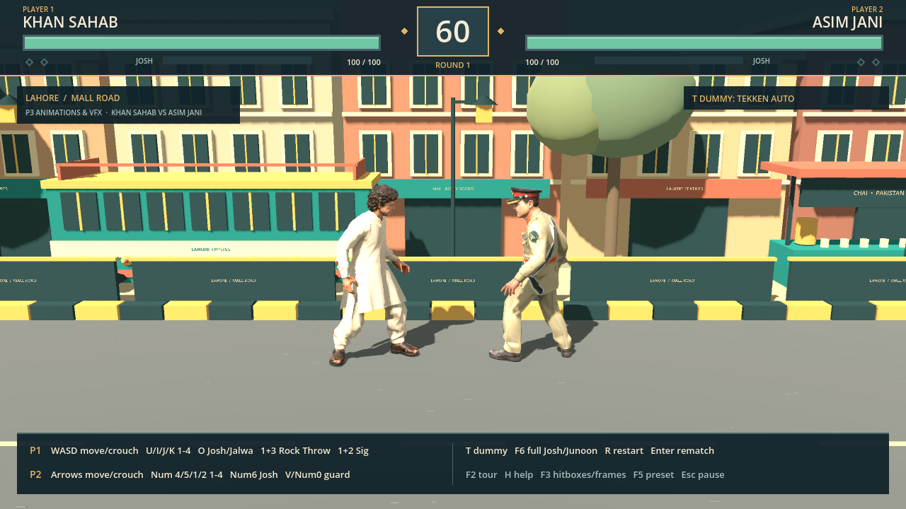 | 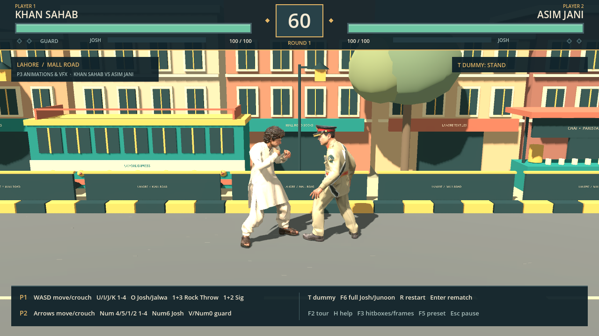 |
| **Round Entry (Khan Walk-In)** | **Running Turn 180** |
| 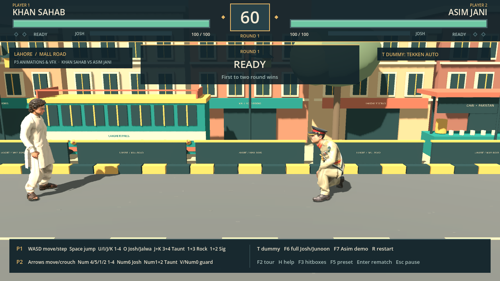 | 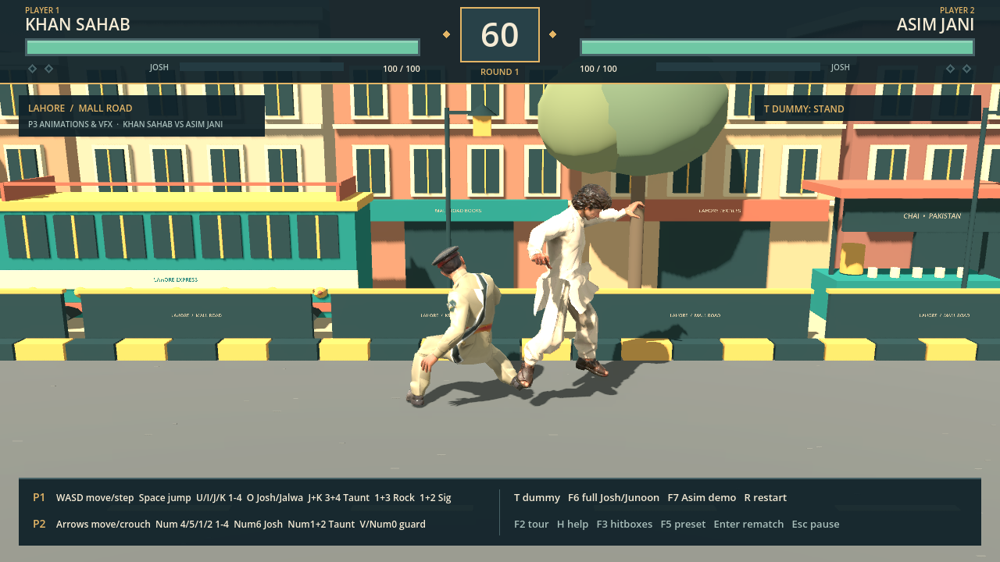 |
| **Patthar Throw Pickup** | **Patthar HitHead + Jagged Shards** |
|  | 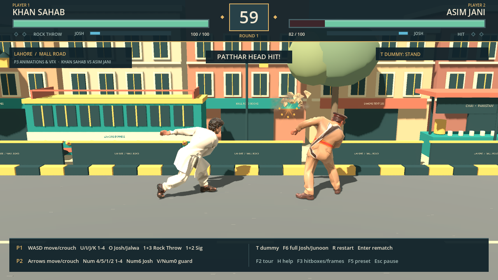 |
| **Asim M1911 Pistol Shot** | **Pistol Bullet Hit** |
| 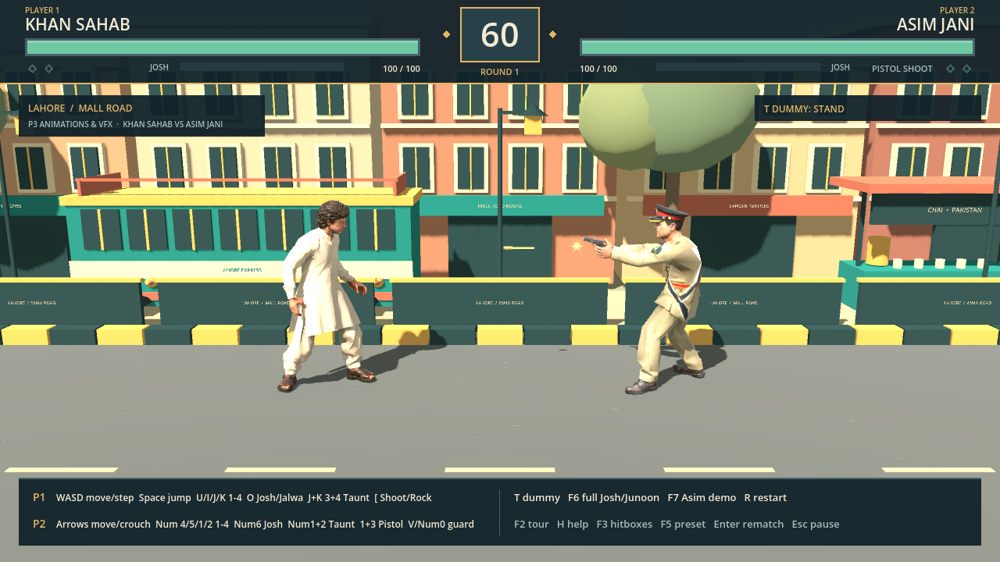 | 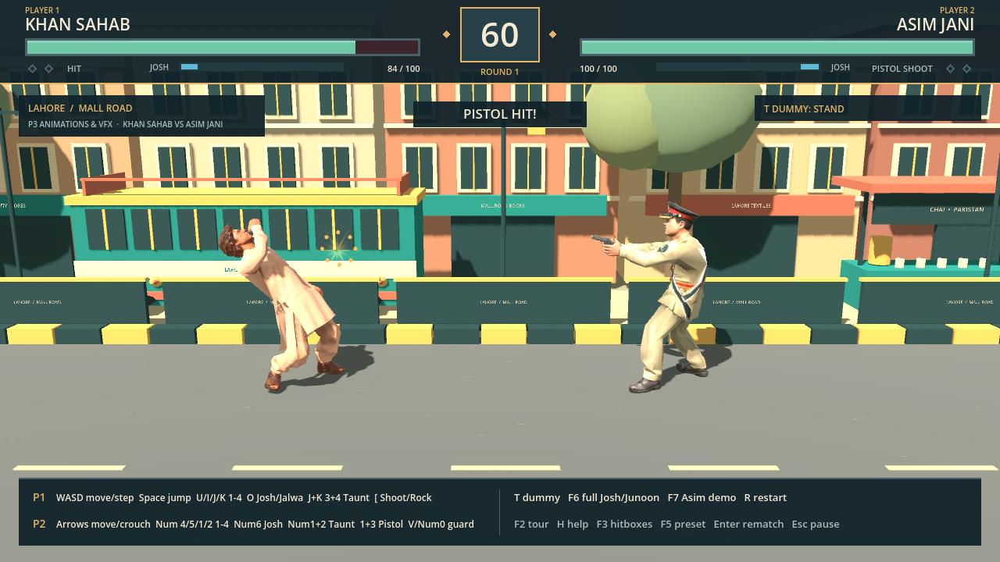 |
| **Full-Junoon Fire Aura (`Josh 100`)** | **Reworked `JalwaSuper` Startup & Finisher** |
| 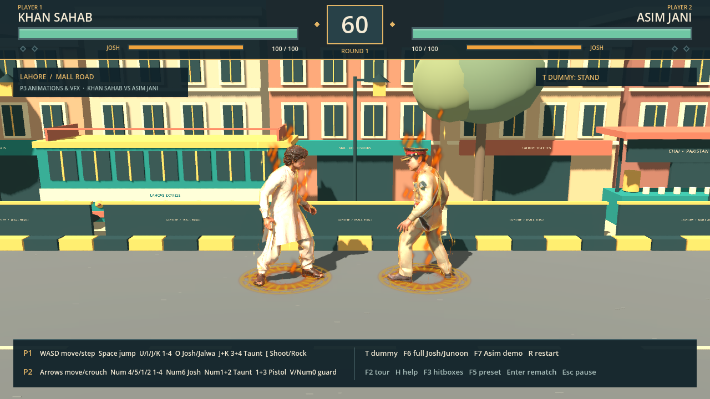 | 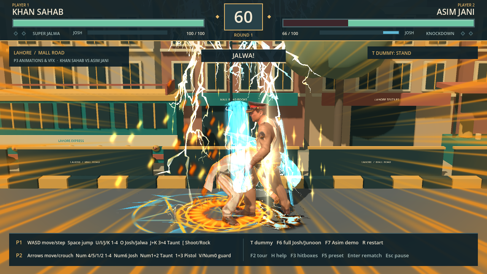 |
| **Aerial Punch (`JumpPunch`)** | **Aerial Kick (`JumpKick`)** |
| 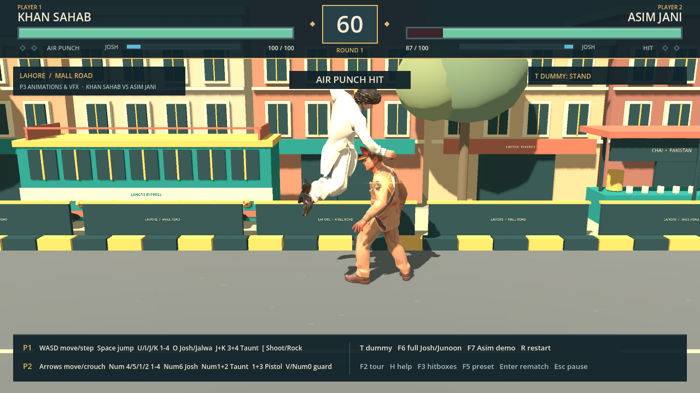 | 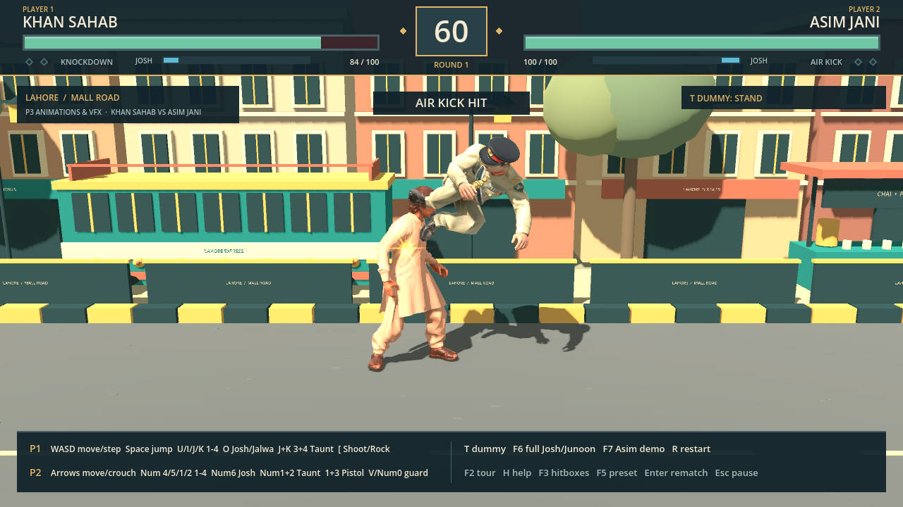 |
| **Hit Knockdown (`SweepFall`)** | **Get-Up (`Stand Up.fbx`)** |
| 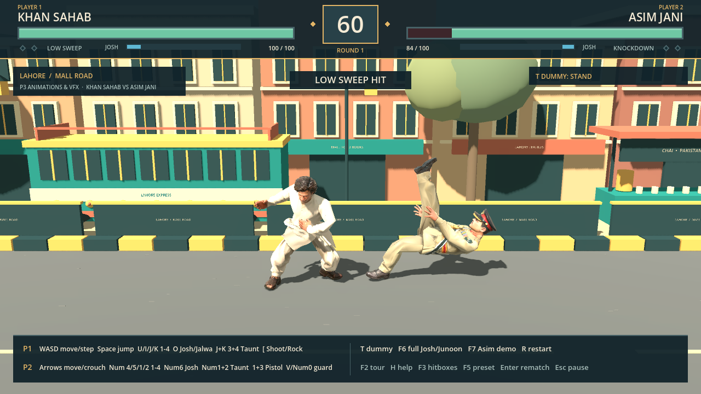 | 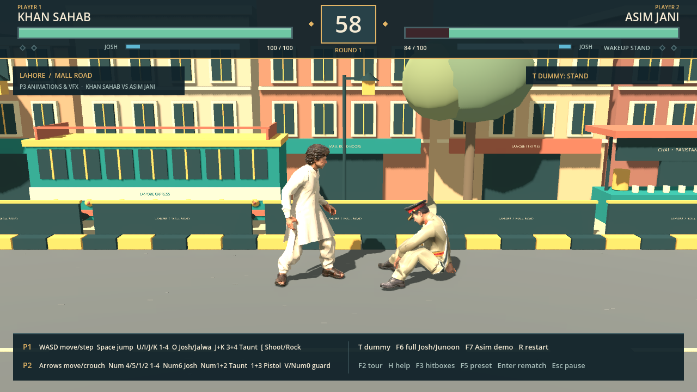 |
| **Khan Taunt (`"ABSOLUTELY NOT!"`)** | **Asim Salute Taunt (`"SALUTE!"`)** |
| 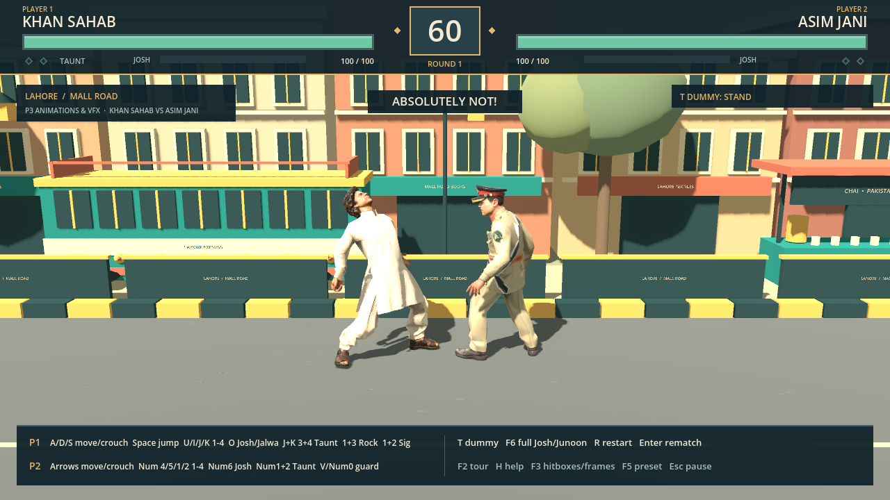 | 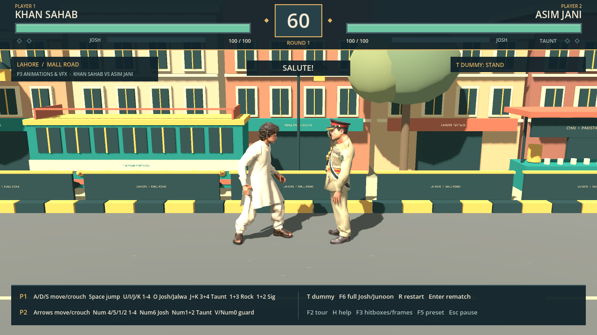 |

## Validation & performance

- **Headless CI suites (`0` failures, `failed: []`, `err_len=0` across all 5 suites):**
  - `--self-test`: **17/17**
  - `--combat-test`: **29/29**
  - `--khan-stage-test`: **39/39**
  - `--determinism-test`: **9/9**
  - `--combat-v2-test`: **110/110** headless (**120/120** rendered incl. 10 screenshot checks in [combat-v2-validation.json](combat-v2-validation.json); `32` frame-data rows [16 Khan, 16 Asim], `0` errors, `spark_pool_size: 48`)
- **Scene geometry cost & Iris Xe `gl_compatibility` benchmark (720p Medium, `--disable-vsync`):**
  - Detaching `FighterView.material_overlay` whenever fire intensity is `0.0` (after 2-frame load-time shader prewarm) restores Part 2 scene-cost parity with zero quality compromise: **`196,834` avg primitives** (vs `197,777` in Part 2; down from `342,338`), **`129` avg draw calls** (vs `134` in Part 2), `200.8 MB` VRAM ([perf-bench-720p-medium.json](perf-bench-720p-medium.json), [stage-p3-bench.png](stage-p3-bench.png)).
  - Measured frame timings on Intel Iris Xe (`30.72 ms` avg / `32.6 avg fps` Medium, `10.02 ms` avg / `99.8 avg fps` Low in the same session) reflected the test laptop running unplugged on battery (`BatteryStatus=1`, `61%`, Balanced power plan, `45%` host CPU load) scaling both Low and Medium identically ~3.5x vs plugged-in baselines (`137.5 avg fps` Med / `298.9 avg fps` Low); re-benchmark on AC power before P4 stage budget sign-off.

## Deferred items (post-P3 / later phases)

- User-planned animation/VFX refinements and individual attack replacements (mostly Asim, some Khan) — kept cleanly extensible via `CharacterDef`/`.tres` & `build_p3_character_anims.py`.
- Final voice recordings dropped into `game/assets/audio/khan_taunt_absolutely_not.ogg` & `game/assets/audio/asim_taunt_salute.ogg` (Part of P5 Audio stack).
- Dedicated `Crouch Walk Backward` clip, foot IK, `SpringBoneSimulator3D` kameez cloth hem, facial expressions, and **Phase P4 — Stage 1 Final (Lahore Mall Road)**.
