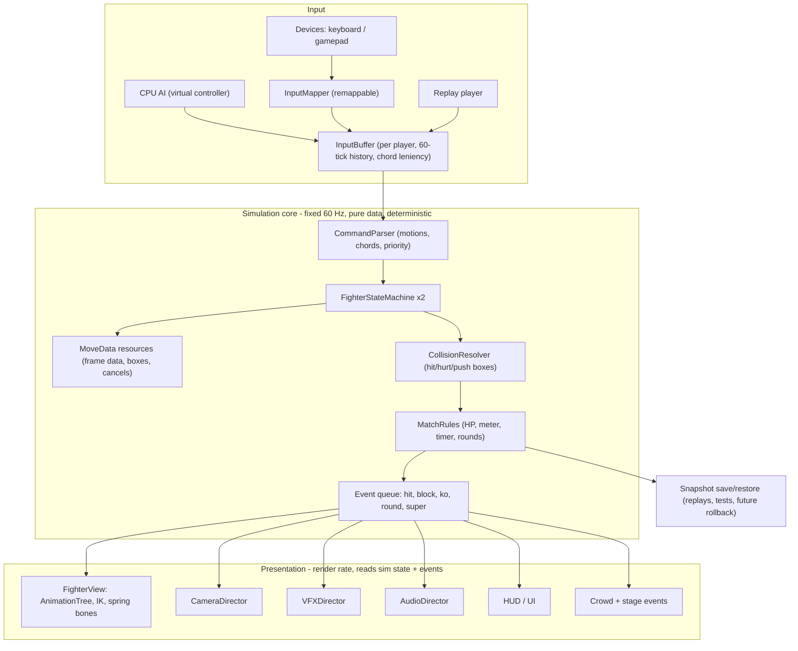

# Rolaa — Full Game Scope, Requirements & Architecture

Version 1.1 · 15 November 2026 · Supersedes the *scope* sections of `pakistani-fighter-gdd-v0.1.md` (that file stays as the decision log / prototype history).

Status labels: **Confirmed** = user agreed · **Recommended** = my proposal, awaiting your yes/no · **Open** = needs your decision (see §15) · **Deferred** = good idea, not in the current release.

Visual target: `character-pipeline/references/gameplay-camera mockup.png` (warm golden-hour Mall Road, decorated bus, chai stall, crowd behind barriers, truck-art HUD). This is the *quality bar for a still frame*. The job of this document is to turn that frame into a game that moves, sounds and plays at that level.

---

## 1. Honest expectation setting (read first)

"Tekken 8 quality" means two different things. We should chase one and be smart about the other.

| Dimension | Tekken 8 reality | Our realistic target | Why |
|---|---|---|---|
| **Game feel** (responsiveness, hit-stop, frame data, combos, readability) | Best in class | **Genuinely close.** This is software engineering, not budget. | Feel comes from a tight 60 Hz sim, input buffering, hit-stop, camera shake, sound sync — all things we fully control. |
| **Visual fidelity** (bespoke mocap, 4K textures, UE5 GI, cloth sim) | 200+ person team, PS5/RTX hardware | **Stylized-realistic "AA indie" look** at 60 fps on Iris Xe | We have image-to-3D bases, Mixamo motion, $0 budget and an integrated GPU. We win on *art direction* (truck-art identity, golden-hour lighting, Pakistani detail) rather than raw polygon count. |
| **Content volume** | 30+ fighters, 15+ stages | 2 polished fighters + 1 polished stage first, then grow | A finished small game beats an unfinished big one — on a resume and for players. |

**Recruiter value is in the engineering:** deterministic fixed-tick combat sim, data-driven move system, frame-data tooling, input buffer, replays, automated tests in CI, a performance budget you hit on weak hardware. The visuals sell the trailer; the architecture sells the interview.

---

## 2. Important risk: real public figures

> [!WARNING]
> Khan Sahab and Asim Jani are recognisably based on Imran Khan and General Asim Munir. Pakistani law (PECA 2016 and its 2025 amendments, PPC defamation sections, and provisions on ridiculing the armed forces) has been used against people for much milder satire than a fighting game where the army chief is beaten up. It also affects publishing (Steam/itch takedowns, likeness claims) and how some employers read your portfolio.

This is your call. I won't refuse to build it either way. The three options:

1. **Keep the real-figure likeness, private/portfolio-only.** Show it in private interviews; never publish it publicly. Lowest effort, highest personal risk if it leaks.
2. **(Recommended) Parody archetypes.** Keep the *vibe* (the kameez-wearing cricketer-politician, the medal-laden general) but use clearly fictional names, altered faces and exaggerated features. "Inspired by Pakistani pop culture", not "is person X". You can publish the trailer, put it on itch.io and talk about it openly.
3. **Original cast of Pakistani archetypes** (rickshaw driver, Pathan chowkidar, Karachi biryani chef, Lahori pehelwan, Gen-Z TikToker, cricket fast bowler, auntie with a chappal...). Safest, most expandable, broadest audience appeal, and avoids politics completely.

Architecture is identical for all three. Only character art, names and voice lines change, so we can start engineering now and decide this before we produce final faces or voice lines.

**Confirmed 15 Nov 2026:** roster = **mix of parody versions and an original Pakistani archetype cast**. Development proceeds with the current Khan Sahab and Asim Jani. Before any public release, the user will decide whether to keep, alter or replace the Asim Jani character. Engineering rule that follows from this: **nothing may hard-code a character.** Names, faces, voice banks and portraits live in `CharacterDef` so a fighter can be renamed, re-skinned or swapped without code changes.

---

## 3. Product vision

**Tone (Confirmed):** a real fighting game with lots of comedy: funny intros, taunts, voice lines, win poses and stage gags. **Voice (Confirmed):** a mix of Urdu and English (code-switching, like everyday Pakistani speech), with subtitles. **Release (Confirmed intent):** public release planned (itch.io first) once the likeness decision is made. Aim for something shareable across Pakistan: trailer, clips, a "viral moment" design.

**Working title (Confirmed): Rolaa (رولا) — "Pakistan's 3D Street Fighter"** (4-word game-defining tagline; Urdu tagline: *"Ab Baat Laaton Se Hogi."*). Earlier candidates: *Dangal* / *Mall Road Mayhem* / *Pakistani Fighter* / *Jalsa Jang*.

**One-liner:** A 2.5D, Tekken-style 3D fighter set in iconic Pakistani locations. It has stylized-realistic fighters, a truck-art visual identity, Urdu/Punjabi trash talk and a roaring street crowd.

**Pillars**
1. **Feels great to hit.** Every strike has anticipation, hit-stop, camera response, sound and a reaction animation. Input → response ≤ 3 frames of added latency.
2. **Unmistakably Pakistani.** Locations, props, signage in Urdu, truck art, chai, rickshaws, dhol, crowd chants. This is the USP. No other fighter looks like this.
3. **Readable and fair.** Clear high/mid/low, visible startup, consistent frame data, training mode with hitboxes.
4. **Finished and polished at small scale.** Menus, transitions, sound, options, a Windows build that just works.
5. **Humour with craft.** Funny intros, taunts and win poses, built on a serious combat system.

**Platform:** Windows desktop (keyboard + gamepad). 1280×720 baseline, 1920×1080 on capable machines.
**Audience:** Pakistani/South-Asian diaspora gamers, fighting-game casuals, portfolio reviewers.

### 3.1 Title & personality (Confirmed 15 Nov 2026)

**Title: Rolaa** (رولا — Punjabi/Urdu for a ruckus, a commotion, "a scene").
**4-Word Game-Defining Tagline:** **"Pakistan's 3D Street Fighter"** (Urdu tagline: *"Ab Baat Laaton Se Hogi."* — "Now we'll talk with kicks.")
Alternate taglines kept for trailers/posters: *"Har Gali Mein Rolaa."* · *"Izzat Ka Sawal Hai."* · *"Chai Thandi, Mahaul Garam."*

Shortlist that was considered:

| Title | Meaning | Tagline idea | Vibe |
|---|---|---|---|
| **PHADDA** (پھڈا) ★ recommended | Punjabi/Lahori slang for a fight or brawl ("phadda pai gaya" = a fight broke out) | *"Scene On Hai."* | Short, punchy, instantly local, works in English and Urdu, great logo shape |
| **CHHITROL** (چھترول) | A proper thrashing (originally with a shoe) | *"Aaj Kisi Ki Chhitrol Pakki."* | Very funny, very Punjabi |
| **TAAKRA** (ٹاکرا) | Clash / head-on collision | *"Mall Road Ka Muqabla."* | Cooler, more "serious fighter" |
| **ROLA** (رولا) | Commotion, ruckus ("rola pao" = make a scene) | *"Rola Pao."* | Playful, chaotic |
| **MUQABLA** (مقابلہ) | Face-off / competition | *"Street Fighters of Pakistan."* | Clear, broad, slightly generic |
| **KUTTAPA** (کٹاپا) | A beating (Punjabi slang) | *"Kuttapa Guaranteed."* | Hilarious but a bit rough for a store page |
| **MUKKA EXPRESS** (مکا) | Mukka = punch; truck/bus-art feel | *"Next Stop: Your Face."* | Fun, ties to truck art |

Personality kit (Confirmed — user approved announcer, system names and UI copy):
- **Logo:** truck-art lettering with رولا in Nastaliq behind the English wordmark ROLA, mirror/flower motifs.
- **Announcer callouts (Urdu/English mix):** "Round 1 — **Shuru!**", "Fight — **Rola!**", "K.O. — **Khalaas!**", "Perfect — **Kamaal!**", "Time — **Waqt Khatam!**", "Counter — **Ulta Pad Gaya!**", "Final Round — **Faisla Kun!**".
- **System names:** meter = **Josh**, super = **Jalwa**, comeback state = **Junoon**, throw break = **Chhuraao**, perfect round = **Saaf Safaya**.
- **UI copy voice:** cheeky ("Wapis aao?" for Rematch, "Bas kar, bhai" on Quit confirmation).
- Before final choice: search itch.io, Steam and Pakistan's IPO trademark register for clashes (avoid "Dangal": it's already a famous Bollywood film).

---

## 4. Scope tiers (agile — we can move items between tiers)

### Release 1 — "Vertical Slice" (the resume piece) — MUST
- 2 fully playable fighters (Khan Sahab, Asim Jani), each with ~14–18 moves (§6.4).
- 1 fully finished stage: **Lahore Mall Road at golden hour**, with animated crowd, ambient life and one interactive "wall" event (§8).
- Modes: **Local Versus (2P)**, **Versus CPU** (3 difficulties), **Training** (hitbox/frame-data overlay, dummy settings).
- Full flow: splash → title → main menu → character select → stage select → intro cinematics → fight (best of 3) → KO/winner cinematic → results → rematch / character select.
- Options: remappable controls, audio sliders per bus, graphics presets (Low/Medium/High), fullscreen/resolution.
- Full audio: music, ambience, crowd, SFX, announcer, character voice lines.
- Cinematic camera: intros, supers, KO slow-mo.
- Windows export, 60 fps on i5-1135G7/Iris Xe at 720p (Medium preset).
- 60–90 s gameplay trailer + GitHub README + architecture write-up.

### Release 2 — "Content Expansion" — SHOULD
- Arcade mode with a short story: ladder of fights, comic-panel/motion-comic story beats, character endings (§10).
- Stage 2: **Karachi Sea View / Clifton at sunset** (camels, beach, waves). Stage 3: **Islamabad Daman-e-Koh at night** (city lights, Margalla hills).
- Fighters 3–4.
- Replay save/playback, frame-data viewer screen, combo trials.

### Release 3+ — COULD / Deferred
- Fighters 5–8, more stages (Peshawar Qissa Khwani, Hunza/Attabad, Karachi Burns Road, Lahore Anarkali/Minar-e-Pakistan, a truck adda, a cricket stadium).
- Sidestep / full 3D movement (§6.2).
- AI-video story cutscenes.
- Online play (rollback). Our deterministic sim design keeps this door open but it's a separate project.
- Steam page, achievements, controller rumble, photo mode.

**Explicitly out:** open-world/story exploration, character creator, microtransactions, mobile.

---

## 5. Look & feel — art direction

### 5.1 Visual identity
- **Stylized realism:** natural proportions (confirmed), PBR materials, slightly saturated "heightened reality" colour grading. Think Tekken/Street Fighter 6 promo-art warmth, not grey photorealism.
- **Truck-art as the design language:** HUD frames, menu borders, round-start banners, hit-spark shapes (flower/peacock motifs on heavy hits), super-move backgrounds, loading screens. One consistent motif system, built once and reused everywhere.
- **Golden-hour lighting** on stage 1: low warm sun, long shadows, atmospheric haze, dust motes, rim light on fighters.
- **Typography:** one display face (bold, truck-art-lettering style, e.g. a free OFL display font plus Urdu Nastaliq for signage/announcer callouts) and one clean UI face.
- **Palette:** truck-art primaries (emerald green, crimson, saffron, royal blue) for UI; warm earth tones for environments. Fighters must contrast with backgrounds (Khan = off-white kameez, Asim = khaki — already good).

### 5.2 Rendering — renderer decision (Recommended spike)
The project is currently on **gl_compatibility**. That's safe on Iris Xe but caps the look: historically no SSAO, SSR, SDFGI, volumetric fog, and more limited post-processing. **Forward+ (D3D12/Vulkan)** unlocks these and Iris Xe can run it at 720p if we're disciplined.

**Recommendation:** a 2-day **renderer spike**. Same stage + both fighters, measure frame time in Compatibility vs Forward+ (with SSAO, glow, fog, tonemapping on). Pick the one that gives the best image under 16.7 ms. Keep quality presets so Low falls back to the cheap path. **Approved 15 Nov 2026:** run the spike; adopt whichever renderer gives the best image the laptop can sustain within budget.

Look features (whichever renderer wins):
- Baked lighting (LightmapGI) for static stage geometry + one real-time directional sun for fighter shadows. The biggest single quality jump for the cost.
- ReflectionProbe for glossy surfaces (bus paint, shop glass).
- Tonemapping (AgX/ACES) + colour-grade LUT per stage + bloom/glow (subtle, on sun and lamps, never on UI).
- Fighter rim light + contact shadow decal under feet.
- Particles: dust kicked on landings, chai steam, pigeons, paper litter blowing, hit sparks, sweat/spit on heavy hits.
- Character shaders: subsurface-ish skin approximation (wrap lighting), fabric sheen on kameez, damage/dirt overlay that builds through rounds (cheap and very "next-gen feeling").

### 5.3 Characters — asset quality targets
| Item | Current | Target |
|---|---|---|
| Triangles (LOD0, in fight) | ~285k each | **40k–70k** each (decimate + bake normal from high-poly) |
| Textures | 2K basecolor/RM/normal | 2K body, separate 1K–2K head with hand-cleaned face; ORM packing |
| Skeleton | Mixamo 41 / 65 bones + drape bones | Mixamo body + face (jaw, eyes, brows) bones or 6–10 blendshapes |
| Cloth | Baked drape bones (Khan) | Drape bones + runtime spring bones (Godot `SpringBoneSimulator3D`) for kameez hem, Asim's sash |
| Face | Static | 6 expressions: neutral, angry, pain, shout, smug, KO |
| Costumes | 1 each | 1 + one alternate colour palette (cheap, shader swap) |

### 5.4 Stage quality targets (Mall Road)
- **Foreground (playable plane, ±14 units):** real geometry with collision; road with decals (cracks, paan stains, lane paint), curb with yellow-black paint, barriers.
- **Midground (5–30 m):** modular building kit (colonial-era Mall Road facades: arches, balconies, signage), decorated bus, rickshaws, chai stall, lamps, trees with wind sway. Every asset here must survive the cinematic camera angles.
- **Crowd:** 20–40 low-poly animated spectators (3–4 base meshes × colour/texture variation × 6 Mixamo cheer/idle clips, random phase), reacting to big hits/KO via animation state. Distant crowd on cards/impostors.
- **Background (>30 m):** GPO / clock tower / skyline on matte-painted cards, sky dome, distant traffic on cards.
- **Ambient life:** passing traffic behind barrier, pigeons, flag/bunting sway, vendor animations, flickering shop sign.

---

## 6. Gameplay design

### 6.1 Feel references
- **Tekken 8:** 4-limb button layout, strings, launchers/juggles, Heat/Rage comeback system, wall splats, stage breaks.
- **Street Fighter 6:** readability, Drive-system-style meter, accessibility ("modern controls").
- **Mortal Kombat 11:** cinematic camera on specials.

### 6.2 Movement model — 2.5D vs 3D
- **Recommended for R1: 2.5D plane** (what we have). Fighters always face each other on one axis. Simpler AI, hitboxes and camera, and the game is still "Tekken-like".
- **Sidestep (Confirmed 15 Nov 2026: Option B, sidestep-lite in R1).** Tekken's defining 3D move: a quick double-tap of up or down steps the fighter *into* or *out of* the screen to dodge straight-line attacks. Options considered:
  - **A. No sidestep in R1** (pure 2D plane, like Street Fighter). Cheapest.
  - **B. "Sidestep-lite" in R1 (Recommended):** double-tap up/down = a quick step off the line and back (~20 frames), with an invulnerability window against *linear* attacks. Each move gets one `tracking` flag (linear / homing). Fighters stay on one plane for collision; the step is mostly visual, with a small camera swing. About 10–15% extra combat work, and it buys most of the Tekken feel.
  - **C. Full 3D movement** (sidestep + side-walk + fighting axis rotating around the stage). True Tekken. Every move needs 3D hit volumes and tracking data, the camera orbits, and the stage must look finished from many angles. Roughly 2× the camera/stage/combat work. Deferred to R3.
  Positions are stored as 3D vectors from P0 either way, so moving from A or B to C later doesn't need a rewrite.

Movement set R1: walk forward/back, dash forward (→→), backdash (←←), crouch, crouch-walk, jump (neutral/forward/back), get-up options after knockdown (stand, roll back, quick-rise).

### 6.3 Controls — Tekken-style 4 limbs (Confirmed 15 Nov 2026)
| Button | Function | Keyboard P1 | Keyboard P2 | Gamepad (Xbox) |
|---|---|---|---|---|
| LP (1) | Left punch / light punch | U | Num4 | X |
| RP (2) | Right punch / heavy punch | I | Num5 | Y |
| LK (3) | Left kick / light kick | J | Num1 | A |
| RK (4) | Right kick / heavy kick | K | Num2 | B |
| Josh (Heat) | Comeback/meter action | O | Num6 | RB |
| Move | — | WASD | Arrows | Stick / D-pad |

- **Guard (Confirmed: Tekken-style):** standing still with no input **automatically guards high and mid attacks**, and holding back also guards (while walking backwards). Holding down / down-back = crouch guard, which blocks lows; highs whiff over a crouching fighter, but mids hit it. You are only open while attacking, recovering, walking forward, jumping or already in hitstun. "When in doubt, don't press anything" is a valid defence, exactly as in Tekken. Replaces the current held block button (kept only as a debug/accessibility option).
- **Simultaneous presses** (your "punch and kick together" question): handled by the input buffer with a **3-frame leniency window**. Presses landing within 3 ticks of each other count as one chord.
  - LP+LK = **Throw** · RP+RK = **Throw (alt)** · LP+RP = **Signature move** · LK+RK = **Taunt / quick-rise**
  - LP+RP+LK+RK (or Josh) = **Super ("Jalwa Attack")** when meter is full / low health
- **Command inputs:** simple motions only (→→, ↓↘→ quarter-circle, ←→ charge-free). Keep execution friendly, which suits a casual audience.
- **Priority resolution:** chords > command motions > single buttons; within single buttons, latest press wins. Pressed-on-same-tick ties resolved by a fixed table so behaviour is deterministic.
- **Accessibility (Should):** "Easy mode" 1-button specials (Josh + direction).

### 6.4 Move list per character (R1 target: 14–18 moves)
| Category | Count | Examples |
|---|---|---|
| Jabs / pokes | 2 | 1 (i10 jab), 2 (straight) |
| Kicks | 2 | 3 (low kick), 4 (mid roundhouse) |
| Crouching | 2 | d+1 crouch jab, d+3 low sweep |
| Strings (2–3 hit combos) | 2 | 1,2,4 · 1,1,2 |
| Launcher | 1 | uf+4 / df+2 → enables juggle |
| Command/heavy moves | 2–3 | f+2 overhead, b+4 power kick, QuadPunch, RoundhouseKick, Headbutt |
| Throws | 2 | front throw, back throw (+ throw break) |
| Signature | 1 | Khan: "Bouncer" cricket-bowling punch · Asim: "Salute & Strike" counter-parry |
| Super (Jalwa) | 1 | cinematic camera, ~30–35% dmg |
| Aerial | 1–2 | jump punch, jump kick |
| Taunt / intro / win poses | 3 | humour beats |

Character styles (fictional gameplay roles):
- **Khan Sahab — "Kaptaan" rushdown:** fast forward dash, cricket-inspired moves (bowling-arm overhead, bat-swing sweep, "no-ball" feint), pressure strings. Signature: *Bouncer*.
- **Asim Jani — "Commander" counter/zoner-lite:** slower, heavier hits, parry/counter stance, long-range kicks, armour on heavy moves. Signature: *Salute & Strike* (parry → cinematic counter).

### 6.5 Combat systems
- **Hit levels:** High (whiffs on crouch), Mid (must stand-block), Low (must crouch-block), Unblockable (super start-up only).
- **Frame data per move:** startup / active / recovery, on-hit and on-block advantage, damage, chip (0 for R1 except super), hitstun, blockstun, pushback, hit-stop frames, hit-level, properties (launcher, knockdown, armour, tracking).
- **Counter-hit:** hitting during the opponent's startup → bonus damage + longer stun + special spark/sound.
- **Combo system:** strings (fixed sequences with cancel windows), juggles after launcher with **damage scaling** (100%, 80%, 70%, 60%…) and juggle gravity to prevent infinites.
- **Josh meter (Heat/Rage-like):** fills from dealing and taking damage; on full, enables one Super or a power-up state (faster, chip damage). Comeback mechanic: low HP (<25%) grants auto "Josh" state once per round.
- **Throws:** 1-frame-tech window (~14 frames) to break with matching button.
- **Knockdown / wake-up:** knockdown → ground state → get-up options; limited oki.
- **Walls:** stage edges are barriers/bus/rickshaw → **wall splat** (combo extender). Optional R1 "stage break": on a heavy KO-range hit near the chai stall, it collapses (pure presentation, scripted).
- **Round rules (Confirmed in prototype):** 100 HP (internally use 1000 for granularity, display as %), 60–99 s timer, best of 3, timeout = more HP wins, draw = replay round.

### 6.6 CPU AI (R1)
- Reads the same sim state as a human; outputs the same inputs through a virtual controller (no cheating access).
- Utility-based decision layer (range, frame advantage, opponent state, own HP/meter) + a library of "plans" (poke, whiff-punish, pressure string, anti-air, block-then-punish).
- Difficulty = reaction delay (25/15/8 frames), block probability, combo knowledge, input mistakes.

---

## 7. Animation system (how multiple animations work together)

### 7.1 Golden rule (Confirmed in GDD)
**The simulation drives the animation; the animation never drives gameplay.** Damage, hitboxes and timing come from frame data at 60 Hz. Animation is time-warped to match.

### 7.2 Per-move phase sync (already started with TimeSeek)
Each `MoveData` maps its clip to phases:
```
clip "Punch": anticipation 0.00–0.42 s  → startup 6 ticks
              contact      0.42–0.55 s  → active  3 ticks
              return       0.55–1.07 s  → recovery 14 ticks
```
Playback rate per phase = clip phase length / tick phase length. The fist visually connects exactly on the active frame, no matter which Mixamo clip we use. This is what makes Mixamo clips feel "fighting-game snappy" instead of floaty.

### 7.3 AnimationTree structure per fighter
```
StateMachine (locomotion layer)
 ├─ Idle/Guard stance (loop, blend Idle ↔ Fight Idle)
 ├─ Walk F/B (BlendSpace1D on velocity)  · Dash · Backdash
 ├─ Crouch (enter / loop / exit) · Crouch-walk
 ├─ Jump (takeoff / air / land)
 ├─ Move (TimeSeek driven by sim tick — all attacks, throws, supers)
 ├─ Reaction (hit high/mid/low × light/heavy, block stand/crouch, launch, juggle, wall splat)
 ├─ Knockdown → Ground → Get-up variants
 └─ Intro / Taunt / Win / Lose / KO
+ Additive layers: breathing, flinch, head look-at opponent
+ Post-process: foot IK (ground lock), hand IK on throws, spring bones (cloth)
```
- **Transitions:** 2–4 frame blends into attacks (fast), 6–10 frame blends out of recovery; reactions snap in at 0–1 frames (impact must be instant).
- **Hit reactions:** chosen by hit level × strength × direction → 8–12 reaction clips per rig, shared across characters via retargeting.
- **Throws / paired animations:** both fighters snap to an authored relative offset; one paired clip pair per throw.
- **Root motion:** off for gameplay (sim owns position); authored displacement curves in `MoveData` instead.

### 7.4 Animation sources ($0)
1. **Mixamo** (already in pipeline): locomotion, generic strikes, reactions, crouch, knockdowns, cheering crowd.
2. **Video-to-mocap free tiers / open source** (e.g. FreeMoCap, Rokoko Vision free, DeepMotion free credits): record yourself or friends doing signature moves, intros and taunts → retarget. This gives *unique* character moves, which matter more than anything else for "not looking like an asset flip".
3. **Hand-keyed in Blender** (via MCP scripts): polish key poses, exaggerate anticipation/follow-through, signature moves, facial.
4. Retarget script already proven for Asim (world-space retarget, A-pose fix) becomes a **reusable pipeline tool**.

Animation requirement list per character for R1: ~45–60 clips (≈20 shared reactions/locomotion + ≈25–40 unique attacks/intros/poses).

---

## 8. Camera system

| Camera | When | Behaviour |
|---|---|---|
| **Gameplay** (Confirmed tracking) | Fighting | Tracks fighters' midpoint, smoothing, **dynamic zoom** on spacing (Recommended), slight vertical follow on jumps/juggles, stage clamps. Subtle *Tekken-style slow rotation* following the fighters' axis so the stage feels 3D. |
| **Impact** | Hits | Shake scaled by hit strength (trauma model), micro-zoom punch-in on counter-hits, hit-stop freeze. |
| **Intro cinematic** | Round 1 start | Authored camera rail per character intro (3–5 s, skippable). |
| **Round/Fight callout** | Each round | Quick sweep across the stage + crowd. |
| **Super cinematic** | Super/signature | Cut to authored angles (2–3 shots), time-scale gameplay, return to gameplay cam. |
| **KO cinematic** | Final KO | Slow-mo (0.25×) orbit around the KO'd fighter, then winner pose cam. |
| **Wall splat / stage break** | Event | Short punch-in from a side angle. |

Implementation: a `CameraDirector` with priority-based virtual cameras (shots blend by priority). The free **Phantom Camera** addon or a small in-house equivalent. Every authored angle needs the stage to hold up from that angle, so **lock the camera envelope before final stage art** (GDD rule, still valid).

> [!NOTE]
> "Multiple camera angles while fighting" in Tekken means the gameplay camera rotates slightly as fighters move and cinematic cameras take over for supers/KOs. The camera never changes mid-exchange in a way that flips controls. We follow the same rule: player-facing direction never changes because of a camera cut.

---

## 9. Audio design

### 9.1 Buses (Confirmed): Master → Music, Ambience, Crowd, Combat, Voice, UI
Ducking: Voice & super stingers duck Music/Ambience by ~6 dB; Combat always cuts through.

### 9.2 Content list (R1)
| Category | Content | Count (approx.) |
|---|---|---|
| Music | Menu theme, character-select, stage theme (dhol/tabla + electronic, "Coke Studio meets fighting game"), victory sting, KO sting | 5 tracks |
| Ambience | Mall Road: traffic hum, distant horns, rickshaw putt-putt, birds, vendors calling | 1 loop + 10 one-shots |
| Crowd | Idle murmur, cheer on hit, big "OHHH" on counter/super, chants ("Khan! Khan!"), gasps, laugh on taunt, KO roar | ~25 clips |
| Combat | Whooshes (light/heavy), hits (light/medium/heavy/counter), blocks, throws, body falls, footsteps (road), cloth swishes, wall splat, super charge | ~60 clips with 3–4 variations each |
| Voice per character | Intro lines, taunts, attack grunts, pain, KO scream, win quotes, super call-out | ~40 lines each (Urdu/Punjabi/English mix) |
| Announcer | "Round 1/2/Final", "Fight!", "K.O.!", "Perfect", "Time!", character names, "Josh!" | ~20 lines |
| UI | Move, select, back, confirm, start | ~8 |

### 9.3 Sources ($0)
Freesound (CC0/CC-BY), Sonniss GDC free bundles, Kenney audio, self-recorded foley (punch a pillow, slap leather, clothes swish), self-recorded/friend voice acting. ElevenLabs free tier for SFX/ambience gaps and the announcer.

**AI voice plan (Confirmed direction: open-source TTS for Urdu/English lines).** Run a short **voice spike**: 10 identical test lines (calm, shouting, taunt, code-switched Urdu/English) through 3–4 local models and pick by ear. Candidates to evaluate (verify each model's current licence and Urdu quality at test time):
- **Chatterbox (multilingual)** — permissive licence, Hindi support, emotion/exaggeration control (good for shouting).
- **Kokoro** — tiny and fast, Apache-2.0, has Hindi voices; less expressive.
- **AI4Bharat Indic Parler-TTS / IndicF5** — trained on South-Asian speech, text-described voice style.
- **XTTS-v2 / Fish Speech / F5-TTS** — very expressive, but model weights are **non-commercial**. Fine for a free release, a blocker if the game is ever monetised.

Practical notes: spoken Urdu and Hindi sound nearly identical, so Hindi-capable models usually handle Urdu written in Devanagari or carefully romanised. Keep a pronunciation sheet per line. TTS is weak at grunts, efforts, pain and KO screams, so record those yourself (cheap and more convincing). Generate only original character voices; never clone real people's voices. Keep the generation script + seeds in the repo so lines can be regenerated when the script changes.

> [!CAUTION]
> Do **not** AI-clone the real people's voices. That is the highest-risk thing in the whole project, legally and reputationally. Use original voice performers doing an *impression-free* character voice.

### 9.4 Implementation
`AudioDirector` subscribes to sim events (hit, block, KO, round start), picks variations (no repeats), randomises pitch ±5%, enforces cooldowns for crowd/voice, and syncs announcer to round flow. Combat SFX trigger on the sim tick of contact (frame-perfect with hit-stop).

---

## 10. Story & presentation

### 10.1 Story concept (Recommended, light and fictional)
**"Dangal-e-Pakistan."** A mysterious, flamboyant TV host (*"Chaudhry Sahab"*, announcer voice) launches a live, nationally televised street-fighting tournament. The prize is the *Golden Chai Cup*, a ridiculous trophy everyone desperately wants for their own reasons. Each fighter has a comedic motive and a rival. Fights happen live across iconic locations, with the host's broadcast as the framing device (on-screen "LIVE" bugs, tickers in Urdu, sponsor jokes). Very fitting for Pakistani TV culture and easily expandable to new characters/stages.
- Arcade: 5–6 fights → rival fight → final boss (the host himself, R2+).
- Each character: intro story panel, mid-ladder rival scene, ending (3–5 panels).

### 10.2 Cutscene production options
| Option | Quality | Consistency | Cost/effort | Recommendation |
|---|---|---|---|---|
| **In-engine real-time cutscenes** (our models + cameras + animation) | Medium–high | Perfect (same models) | High authoring time | Use for intros, supers, KO, win poses (R1) |
| **Motion-comic panels** (in-engine renders + painted/AI-enhanced stills, truck-art frames, voiceover, parallax) | High, stylish | High | Low–medium | **Use for story mode (R2)** |
| **AI video** (Veo/Kling/Runway etc.) | Can look amazing | Characters drift between shots; hard to match in-game models | Credits cost money; free tiers limited | Use for the **opening trailer/attract video** only, if at all |

### 10.3 Presentation polish checklist
Attract/title screen with animated stage, character-select with animated 3D fighter on a pedestal, VS loading screen (truck-art split), round banners, "Perfect"/"Counter" callouts, results screen with stats, pause menu with move list.

---

## 11. Non-functional requirements

| ID | Requirement | Target |
|---|---|---|
| NFR-1 | Frame rate | 60 fps sustained; p99 frame time ≤ 20 ms on i5-1135G7/Iris Xe, 720p Medium |
| NFR-2 | Sim tick | Fixed 60 Hz, independent of render; no gameplay logic in `_process` |
| NFR-3 | Input latency | ≤ 3 frames engine-added (measure with high-speed phone video) |
| NFR-4 | Determinism | Same inputs + seed ⇒ identical match (replay test in CI) |
| NFR-5 | Load time | Match load ≤ 8 s from SSD |
| NFR-6 | Memory | ≤ 2.5 GB RAM, ≤ 1.5 GB VRAM-equivalent |
| NFR-7 | Build | One-click Windows export; no external dependencies; ≤ 1.5 GB |
| NFR-8 | Stability | 30-minute soak test (CPU vs CPU) with no crash/leak |
| NFR-9 | Accessibility | Remappable controls, subtitles for voice, colour-safe hit indicators |
| NFR-10 | Testability | Headless automated tests run in CI on every push |

### 11.1 Performance budget (16.7 ms, 720p, Iris Xe)
| System | Budget |
|---|---|
| Fighters ×2 (render + skinning) | 4.0 ms |
| Stage geometry + lighting | 5.0 ms |
| Crowd + ambient life | 2.0 ms |
| VFX + post-processing | 2.5 ms |
| Sim + AI + animation update | 1.5 ms |
| UI + audio + headroom | 1.7 ms |
Triangle budget on screen: ≤ 400k. Draw calls ≤ 600. Texture memory ≤ 1 GB.

---

## 12. Technical architecture

### 12.1 Layered design


### 12.2 Key modules (Godot 4.7, GDScript; C# or GDExtension only if profiling demands)
| Module | Responsibility | Notes |
|---|---|---|
| `GameFlow` (autoload) | Scene/state flow: title → select → fight → results | State machine, async scene loading with loading screen |
| `MatchSim` | Owns both fighters' sim state, tick(), snapshot/restore | Plain `RefCounted` classes, no Node deps → unit-testable headless |
| `FighterSim` | State machine (idle, walk, dash, crouch, jump, attack, guard, hitstun, blockstun, juggle, knockdown, throw, ko) | Evolves `proxy_fighter.gd` |
| `MoveData` (`Resource`) | Frame data, hit boxes per tick, cancel windows, properties, anim phase mapping, SFX/VFX ids | Authored in `.tres`; exportable to CSV for the frame-data table |
| `CharacterDef` (`Resource`) | GLB path, model scale, rotation, clip map, move list, voice bank, stats | Replaces hard-coded `khan_stage_fighter.gd` constants (the immediate refactor) |
| `InputBuffer` / `CommandParser` | Ring buffer, motion detection, chord leniency, priority table | Fully unit-tested |
| `FighterView` | Mounts GLB, AnimationTree, TimeSeek sync, IK, cloth, material FX | One generic script for every character |
| `CameraDirector` | Virtual-camera priorities, shake, cinematic shots | |
| `AudioDirector` / `VFXDirector` | Event → sound/particles, pooling | |
| `StageDef` + stage scene | Bounds, walls, spawn points, lighting preset, crowd spawners, stage events | |
| `AIController` | Utility AI producing inputs | |
| Tools (EditorPlugin) | **Hitbox/frame-data editor** with timeline scrubber; move-list CSV export; retarget/import scripts | Strong resume item |

### 12.3 Repo & folder structure (target)
```
game/
  core/        sim, input, rules (no rendering)
  characters/  <name>/ CharacterDef.tres, moves/*.tres, model.glb, audio/
  stages/      <name>/ StageDef.tres, scene, lighting, crowd
  presentation/ camera, vfx, audio, hud, ui
  flow/        menus, select, results, options
  tools/       editor plugins
  tests/       unit + integration (headless)
tools/blender/ pipeline scripts (decimate, retarget, export)
docs/          GDD, scope, architecture, ADRs, devlog
```

### 12.4 Engineering practices (resume-grade)
- **Git + GitHub** with feature branches, PRs (even solo), conventional commits.
- **CI (GitHub Actions):** headless Godot → run unit/integration tests (existing `--self-test`, `--combat-test` grow into a suite) → Windows export artifact on tags.
- **ADRs** (Architecture Decision Records) for renderer choice, input model, determinism, etc.
- **Replay-based regression tests:** recorded input files must reproduce identical end state.
- **Performance CI check:** scripted camera/fight benchmark logging frame-time stats to JSON.
- **Debug overlay (F3):** hit/hurt boxes, frame advantage, input display, state names, frame-time graph.

---

## 13. Content pipeline

### 13.1 Character pipeline (proven for Khan & Asim, now formalised)
1. Reference sheet → image-to-3D base (front/side/back consistency).
2. Blender cleanup: fix face, hands, garment geometry; UV check.
3. **High→low:** decimate to 40–70k, bake normal/AO from the 285k source (keeps detail, fixes performance).
4. Mixamo auto-rig → weight repair (fingers, underarms, garments) via scripts.
5. Retarget clips (reuse Asim world-space retarget script) → NLA → GLB export.
6. Godot import → `CharacterDef` → automated review scene (bone sanity, clip presence, capture sheet).
7. Gameplay hookup: author `MoveData` + hitboxes in the editor tool.

### 13.2 Stage pipeline
Blockout (greybox, camera envelope test) → modular kit modelling (Blender; free CC0 kits from Poly Haven / ambientCG / Kenney for generic props) → texture (Poly Haven/ambientCG CC0 PBR + hand-made Urdu signage decals) → lighting bake → crowd & life → optimisation pass → camera validation at both ends and all cinematic angles.

### 13.3 Free asset sources
Textures/HDRIs: Poly Haven, ambientCG · Models: Poly Haven, Kenney, Sketchfab CC0/CC-BY (check licence each time) · Animation: Mixamo · Audio: Freesound, Sonniss · Fonts: Google Fonts (OFL), incl. Noto Nastaliq Urdu. Keep a `CREDITS.md` with every licence. It's required and shows professionalism.

---

## 14. Roadmap (agile phases; each ends with a playable build + demo)

Each phase = 1–3 sprints of 2 weeks. Durations are indicative; we re-plan after each phase.

| Phase | Goal | Key deliverables | Exit criteria |
|---|---|---|---|
| **P0 – Foundation refactor** *(Complete 16 Nov 2026)* | Architecture ready to scale | `CharacterDef`/`MoveData` resources, generic `FighterView`, both rigged fighters promoted to main scene (`stage_proof.tscn`), git + CI running existing tests | Khan vs Asim rigged fight passes automated checks (48/48 `--khan-stage-test`, 17/17 `--self-test`, 29/29 `--combat-test`) |
| **P1 – Tech spikes** *(Complete 16 Nov 2026)* | Kill the big unknowns | Renderer spike (`gl_compatibility` vs `forward_plus`) + Low/Med/High presets, Blender decimation (`293k→66k` Khan, `285k→62k` Asim), 2-fighter `--perf-bench`, input-latency & determinism harness (`--determinism-test`) | ADR (`docs/adr/0001-renderer-and-lod-budget.md`) locks `gl_compatibility` (87.0 fps avg Med / 298.9 fps Low on Iris Xe) + ~60k tri LOD0; 1-tick input latency & 180-tick replay determinism pass |
| **P2 – Combat core v2** *(Complete 17 Nov 2026)* | Tekken-like system | 4-button input (`LP/RP/LK/RK` + `Josh`), 60-tick `InputBuffer` + `CommandParser` (3f chords w/ kara-upgrade + motions), `high`/`mid`/`low`/`throw` hit levels, Tekken neutral/back/crouch guard, dashes + sidestep-lite (`linear` vs `homing`), counter-hits, string cancels (`1,2,4` / `1,1,2`), launchers/juggles w/ scaling, knockdown/wake-up, throw + 14t Chhuraao break, wall splats, Josh/Junoon/Jalwa super, 13-move `.tres` kits + dynamic `FighterView` clip tree, `F3` hitbox/frame/input overlay, `FrameDataTool` CSV/MD export, pooled sparks | All 13 moves playable per fighter; `--combat-v2-test` (41/41), `--self-test` (17/17), `--combat-test` (29/29), `--khan-stage-test` (39/39 headless), `--determinism-test` (9/9) passing in CI; **93.9 fps** avg at 720p Med on Iris Xe |
| **P3 – Animation pass** *(Complete 22 Nov 2026; refinement/voice `.ogg` later)* | It looks like a fighter | **Part 1:** 28 Mixamo clips on Khan + 14 on Asim w/ `lock_xy=True` (`0.0 m` hip drift), Khan `Patthar Throw` (`cliff_rock.glb` + shards), initial Junoon/Jalwa VFX. **Part 2:** Khan 30 clips (`Taunt`, `BlockHit`, `WakeupStand`) + Asim 31-clip combat kit + `AsimDemo`. **Part 3 & Closeout:** Round `Entry` (Khan walk-in) + KO `VictoryCelebrate` + `Turn180`, Asim `M1911 Pistol Shot` (`m1911_pistol.glb` + `.45 ACP` bullet), reworked `JalwaSuper` w/ 3D lightning/slash/crater VFX & dynamic full-Junoon body fire aura, `SweepFall`/`Stand Up` knockdowns vs `KnockdownDeath` KO, aerial `JumpPunch`/`JumpKick` (`Flying Knee Punch Combo.fbx` & `Drop Kick.fbx` w/ `lock_z=True`), synced `.tres` kits (**36** Khan / **38** Asim clips, **32** `MoveData` attacks), Intel OGL VSync-30fps fix + 2-split shadows | Every state & air attack has a real clip; `0` NaN; **17/17** `--self-test`, **29/29** `--combat-test`, **39/39** `--khan-stage-test`, **9/9** `--determinism-test`, **110/110** headless (**120/120** rendered) `--combat-v2-test`; **90.3 avg fps** 720p Med uncapped / locked **60.0 fps** live (`133,387` avg prims, `109` draw calls) (**Next: P4 Mall Road**) |
| **P4 – Stage 1 final** | Mall Road at mockup quality | Modular kit, baked lighting, crowd, ambient life, wall events, grading | Side-by-side with mockup approved by you; perf in budget |
| **P5 – Presentation & audio** | Feels like a product | Truck-art HUD + full menu flow, camera director (intros/super/KO), VFX, full audio stack, announcer, voices | Full loop from title to rematch, nothing placeholder |
| **P6 – AI, polish, ship R1** | Resume-ready | CPU AI ×3 difficulties, balance pass, options/remap, soak test, Windows build, trailer, README, devlog | R1 checklist §4 complete |
| **P7+** | R2 content | Arcade/story, stages 2–3, fighters 3–4, replays | Per-feature |

**P0, P1, P2 & P3 complete (22 Nov 2026); Next: P4 — Stage 1 Final (Lahore Mall Road at mockup quality).** Deferred P3 items queued for later polish/P5: user-planned individual move/VFX refinements (especially Asim), recorded `.ogg` voice files under `game/assets/audio/`, dedicated `Crouch Walk Backward`, foot IK, and `SpringBoneSimulator3D` kameez hem.

#### Phase P3 Complete Status (`outputs/p3-animations/README.md`)
- **Retargeted Mixamo + Motifect clips (`tools/blender/build_p3_character_anims.py`, `outputs/p3-animations/build-report.json`):** `BVH_TO_MIXAMO` 22-bone world-space T-pose delta retargeting alongside Mixamo FBX clips (`0` NaN keyframes, `max_locked_hips_xy_drift_m: 0.0`, `lock_z=True` on air attacks). **Khan Sahab** (`game/assets/characters/khan_recovery_trial.glb`, 65,877 tris, 239 skin joints, 14.47 MB) now has **36 clips**; **Asim Jani** (`game/assets/characters/asim_model1.glb`, 61,999 tris, 65 skin joints, 9.08 MB) now has **38 clips**. Authoritative **32-row** move→clip table (`16` Khan incl. `rock_throw`, `air_punch`, `air_kick`; `16` Asim incl. `pistol_shoot`, `air_punch`, `air_kick`) is synced to disk `.tres` resources via `FrameDataTool.save_default_resources()` (`outputs/p3-animations/frame-data.md`).
- **Part 3 additions (Entries, Victory, Turn180, Pistol, Super/Junoon VFX, Knockdowns & Air Attacks):** Round `Entry` (Khan walks in from afar to fighting mark, Asim `Crouch To Stand`), post-KO victory dances (`Rumba Dancing` / `Silly Dancing` after `KO_FALL_TICKS = 108`), `Running Turn 180`, Asim `M1911 Pistol Shot` (`m1911_pistol.glb` 12,080 tris + `bullet_45acp.glb` 736 tris + muzzle flash + brass casing), reworked `JalwaSuper` with storm dimming, twin 3D lightning bolts (`lightning_bolts.glb`), 3D `SlashWave` (`slash_arc.glb`), crater crack decal, magic rune circle, full-body Junoon fire aura (`junoon_body_fire.gdshader` dynamically attached only while active + volumetric flame shrouds/plumes/embers), `SweepFall` (`KNOCKDOWN_TICKS = 76`) + `Stand Up.fbx` (`WAKEUP_STAND_TICKS = 72`) for hit knockdowns while keeping `KnockdownDeath` for KO, and mid-air `air_punch` (`Flying Knee Punch Combo.fbx`) / `air_kick` (`Drop Kick.fbx`).
- **Verification & perf (`gl_compatibility`):** All 5 headless suites passing with `0` failures & `err_len=0` (`--self-test` **17/17**, `--combat-test` **29/29**, `--khan-stage-test` **39/39**, `--determinism-test` **9/9**, `--combat-v2-test` **110/110** headless / **120/120** rendered in `outputs/p3-animations/combat-v2-validation.json`, `spark_pool_size: 48`, `failed: []`). Detaching `material_overlay` when fire intensity is `0.0`, switching `AfternoonSun` to `SHADOW_PARALLEL_2_SPLITS` (`32.0 m` Medium), caching `sky_dim_factor` writes, and replacing Intel OpenGL's 30fps-halving `VSYNC_ENABLED` with `vsync_mode=0` + `Engine.max_fps = 60` yielded **90.3 avg fps** (`11.07 ms` avg, `p50 8.16 ms`, **`133,387` avg primitives**, **`109` avg draw calls**, `200.8 MB` VRAM in `outputs/p3-animations/perf-bench-720p-medium.json`) and rock-solid **60.0 fps** live play on Iris Xe.

### Definition of Done (every feature)
Works with keyboard + gamepad · covered by an automated test where feasible · no frame-budget regression · documented in GDD decision log · no placeholder left unless ticketed.

---

## 15. Open / Deferred for Later (Revisit After R1)

Confirmed 15 Nov 2026 (were questions 1, 3, 4, 7, 8, 11): parody + original cast mix (Asim decision before public release) · Tekken 4-limb buttons · Tekken auto-guard/hold-back guard · comedy-rich tone · Urdu + English voice mix · public release intended.

Also confirmed 15 Nov 2026: sidestep-lite (Option B) in R1 · R1 roster = Khan Sahab + Asim Jani; original cast comes in R2+ · open-source AI voices (voice spike) · renderer spike approved (best image within budget wins).

Also confirmed 15 Nov 2026 (round 3): title **Rolaa (رولا)** with 4-word game-defining tagline **"Pakistan's 3D Street Fighter"** (and Urdu tagline *"Ab Baat Laaton Se Hogi."*) · Khan base model = **`khan_recovery_trial.glb`** (latest repaired build: chaak webbing removed, thigh poke-through fixed, 0 garment overlaps) · Stage 2 decided only **after** Mall Road + the full 2-character game ship. Candidates: Karachi Sea View, or Islamabad with Faisal Mosque in the background (see note below).

> [!NOTE]
> Faisal Mosque stage: fight on the road/plaza in front, with the mosque as the backdrop. No fighting inside the mosque grounds, no comedy gags involving the mosque, and respectful crowd/props there. That avoids offence and platform/legal trouble while keeping the iconic skyline.

Open scope (deferred — revisit later, does not block R1):
1. **Story mode framing:** e.g. *"Rolaa Live!"* as a televised street-fight show.
2. **Online play:** keep deferred for now (simulation stays deterministic so rollback remains possible later).
3. **Original cast (R2):** which archetypes come first after Release 1 (rickshaw driver, pehelwan, fast bowler, chowkidar, biryani chef, TikToker, auntie...).

## 16. Idea backlog (not committed)
- Damage/dirt build-up on clothes and faces across rounds.
- Stage time-of-day variants (Mall Road at night with lit signs) from the same geometry.
- Crowd members holding phones up that "film" big moments, plus a post-match "viral clip" replay of the best combo.
- Rickshaw drives through the background between rounds; chai-wala reacts to fights near his stall.
- "Load-shedding" stage hazard: lights cut for 3 seconds (a fun, very Pakistani round event, toggleable).
- Character-specific round-win banners in truck-art poetry style (lettering on the back of trucks).
- Training mode "Ustad" tips in Urdu.
- Photo mode for marketing shots.
